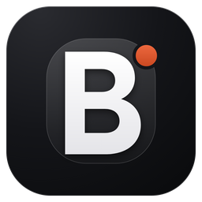
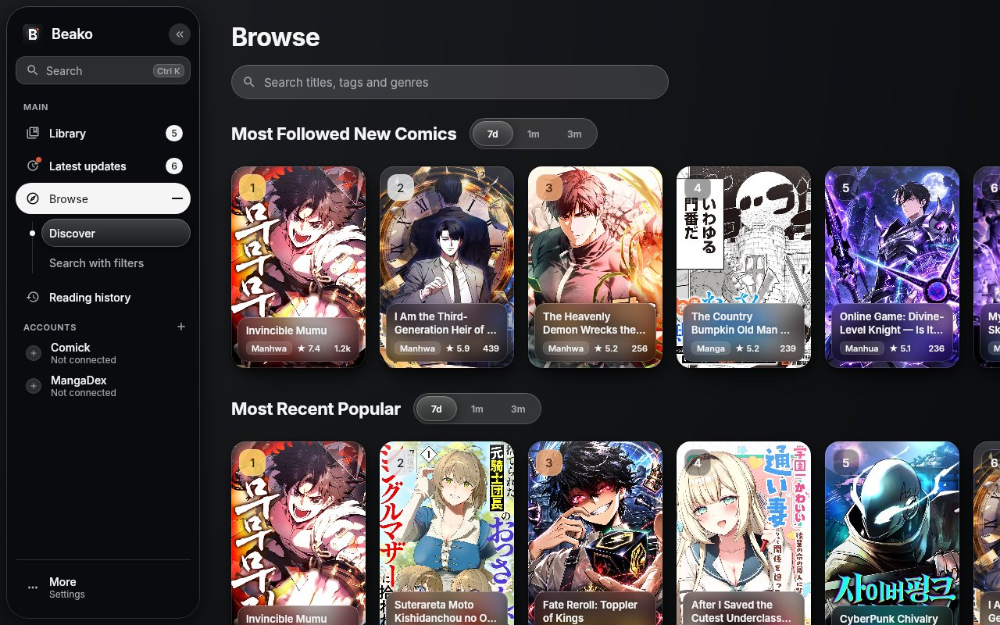
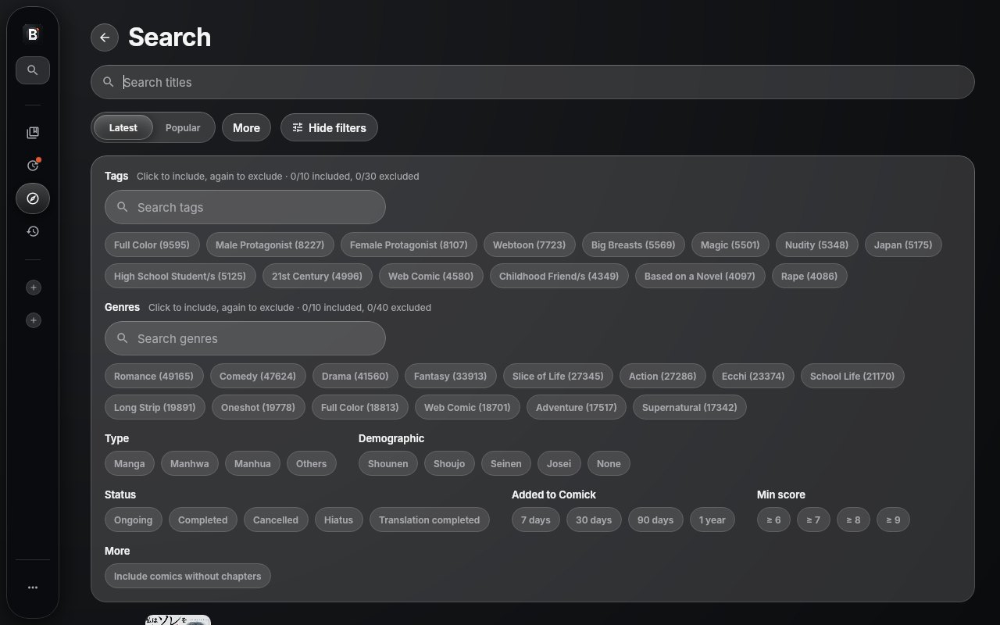
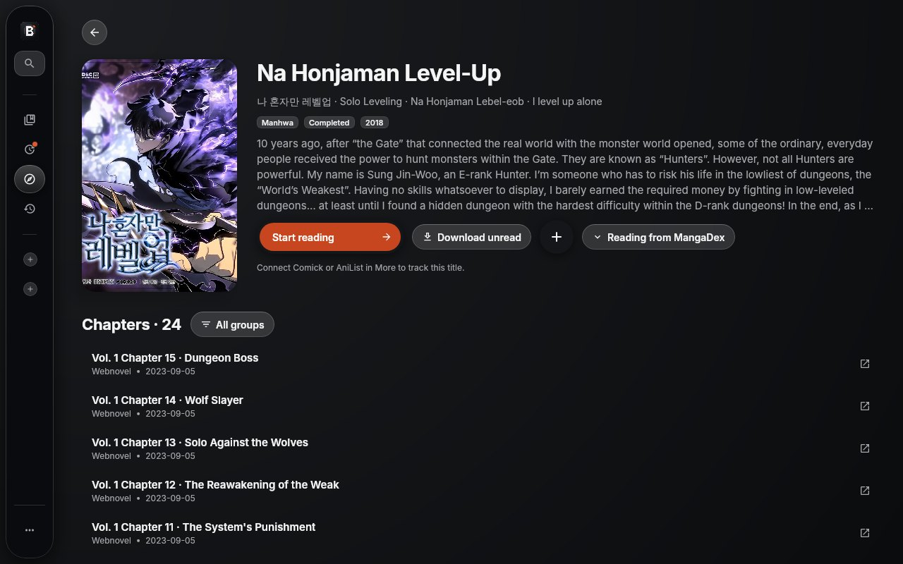
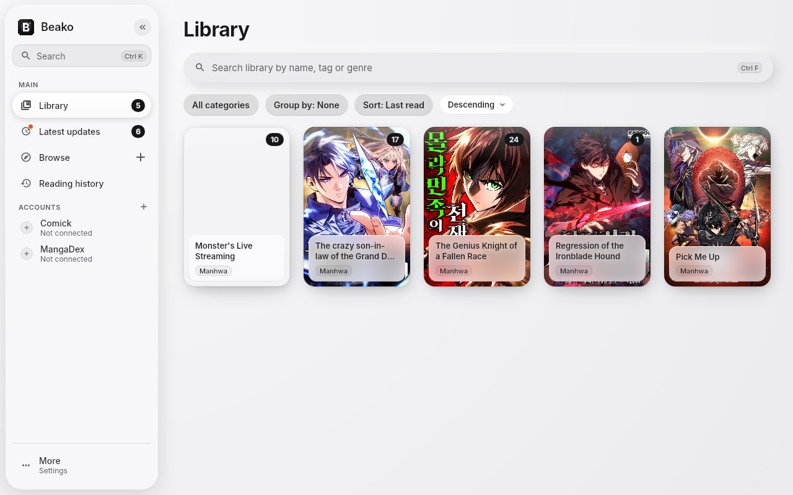

<div align="center">



# Beako

**A manga reader for Windows.** Discover with Comick's tags and charts, read from MangaDex and the sources you add, and track on Comick and AniList, in a neutral liquid-glass window.

[](https://github.com/SHELIDRAN/Beako/releases/latest)




</div>

## Install

1. Download **`Beako-<version>-windows-x64.msi`** from the [latest release](https://github.com/SHELIDRAN/Beako/releases/latest).
2. Run it. New versions upgrade the installed one in place; your library and settings stay.
3. The installer isn't code-signed yet, so Windows SmartScreen may warn you: choose **More info → Run anyway**. The `.sha256` file next to the installer lets you check the download.

Beako runs on 64-bit Windows 10 and 11 and bundles its own Java runtime, so there's nothing else to install.

## Features

### Discover
- **Browse** two ranked shelves from [Comick](https://comick.dev), the most followed new comics and the most recent popular, over the last 7 days, month or three months.
- **Search with tags you can include or exclude.** Included tags are all required, as on Comick, so "female lead + comedic misunderstanding" finds titles with both. Filter by genre, type, demographic, status, how recently a title was added and minimum score.
- **MangaDex as a fallback.** When Comick can't answer (it's down, rate-limited or finds nothing), Beako searches MangaDex instead and says so, with a **Try Comick again** button.

### Read
- **Updates from inside the app.** Beako tells you when a new version is out; **Update now** downloads it, checks it, installs it over the old one (your library and settings stay) and reopens Beako. More › About has Check for updates.
- **MangaDex discover page.** Browse › MangaDex shows Popular new, Latest updates, Recently added and Top rated, plus your **Feed** of new chapters from titles you follow (sign in under More › Accounts).
- **One title page for every source.** MangaDex is built in; add Mangayomi-format sources from a repository you choose: JavaScript sources, and Dart sources built on the Madara, MangaReader and MangaBox site templates (Beako runs its own JavaScript ports of those templates, from Mangayomi's Apache-2.0 extensions). Sources are third-party code and run sandboxed. The **Reading from** picker shows every source's state (matched, no match, checking, failed), searches any of them by hand with the title's other names, and remembers your choice.
- **Gaps filled automatically.** When the source you read from is missing a chapter, Beako takes it from another one and labels where it came from.
- **A reader for both comics and webtoons:** paged (left-to-right or right-to-left) or a continuous strip, fit to screen, width or height, split double pages, borderless full screen, and keyboard controls you can rebind. Webtoons are detected for you.
- **Downloads** for reading offline, with a queue you can pause.
- **Manga on your PC:** point Beako at a folder of series (folders of images or `.cbz`/`.zip` chapters) and read them like any other title.
- **Reader options from Neko:** two pages side by side, crop borders, grayscale, a page between chapters, skip read or duplicate chapters, click-zone layouts, pages loaded ahead, and keeping the screen awake.

### Keep track
- **Library** with categories, grouping, sorting and search across names, tags and genres.
- **Latest updates**: Beako checks your library for new chapters on a schedule you set and notifies you.
- **Reading history** by day, resuming where you stopped.
- **Trackers:** sign in to **Comick** and **AniList** (two-way: import your lists, and progress is sent as you read), and **MangaDex** (import follows, mark chapters read).
- **Backup and restore**, automatic daily backups, and import from a Neko (Android) backup.

### Look and comfort
- **Beako Glass**, a neutral liquid-glass design: the covers bring the colour, the interface stays out of their way.
- 35 colour schemes in light and dark: Dynamic, built from your Windows accent colour, Neko's Kitsune Fire, Miami Vice, Nord, Tokyo Night and more, with an option to follow Windows' light or dark mode. Glass strength, interface size (80–150%), and a menu that collapses to a slim rail or stays open.
- **Reduce motion** and **Reduce transparency**, which also follow Windows' own settings. Every control works from the keyboard with a visible focus ring; Ctrl+K and Ctrl+F jump to search.
- Discord Rich Presence (optional), DNS over HTTPS, MangaDex data saver and an incognito mode.

<div align="center">



</div>

## Sources and privacy

- **Beako ships with no sources besides MangaDex.** You add a Mangayomi extension repository yourself (the [wotaku.wiki list](https://wotaku.wiki/ext/mangayomi) is a starting point) and install sources from it. Sources are **third-party code**: Beako runs them in a sandbox with no access to your files or local network, a time limit and size limits on what they download.
- **Comick is used for discovery and tracking only.** Beako never reads chapters or page images from Comick, and never offers it as a reading source.
- **Sign-ins stay on your PC.** Comick and AniList use their official sign-in pages; Beako keeps the refresh tokens in Windows Credential Manager and never stores your passwords. Each token is only ever sent to the service it belongs to.
- If something goes wrong, `%APPDATA%\Beako\beako.log` records source failures and errors (never tokens or passwords); attach it to an [issue](https://github.com/SHELIDRAN/Beako/issues/new/choose).

## Build from source

You need JDK 21. The Android modules from upstream stay in the repository as porting source; `-PdesktopOnly` skips them, so no Android SDK is needed.

```bash
./gradlew -PdesktopOnly :desktop:run
```

```bash
./gradlew -PdesktopOnly build
```

On Windows, build the installer with:

```bash
./gradlew -PdesktopOnly :desktop:packageMsi
```

The app is Kotlin with Compose Multiplatform for Desktop: `desktop/` holds the Windows app, `shared/` the API clients, extension runtime and other logic. `docs/PLAN.md` has the roadmap and `docs/design/beako-glass/` the design system.

## Credits

Beako is a port of **[Neko](https://github.com/nekomangaorg/Neko)**, the Android MangaDex reader, to Windows; thanks to everyone who built it. The extension bridge is adapted from **[Mangayomi](https://github.com/kodjodevf/mangayomi)**. Text is set in [Inter](https://rsms.me/inter/) (SIL OFL 1.1).

Beako isn't affiliated with Comick, MangaDex, AniList, Mangayomi or Neko.

## License

[Apache License 2.0](./LICENSE), like Neko. Upstream copyright notices are kept in the source.
