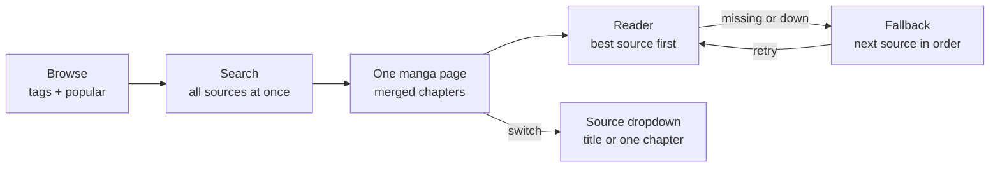

# Beako (Neko for Windows) – Feature Plan

Source of truth: https://claude.ai/artifact/QUEq4JWXrDqzBaP2HnLCc5 (exported Nov 12, 2026)

## Overview

The fork brings [Neko](https://github.com/nekomangaorg/Neko) — the free, open-source, unofficial MangaDex reader — from Android to Windows. Upstream is a Kotlin/Jetpack Compose Android app (Android 8+), forked from Tachiyomi and TachiyomiJ2K, licensed Apache-2.0.

Assumptions to confirm:

- Base is `nekomangaorg/Neko` `main`; keep the Apache-2.0 LICENSE and the upstream copyright notices.
- Goal is a native Windows desktop app (Windows 10/11), not an Android emulator wrapper.
- MangaDex stays the main source; merge sources come later.

## Fork features (your additions)

The fork's headline feature is **one manga page per title that merges every source**, with a source dropdown on that page and automatic fallback when a source is missing chapters.

### 1. Unified manga page (all sources in one)

- Every title gets one canonical page, keyed by its AniList ID (with MangaDex ID as backup), not one page per source.
- On opening, the app searches all enabled sources for that title in parallel and matches results by AniList / MAL IDs, then by normalised title + alt titles.
- Chapter list is merged: one row per chapter number, with the best available source picked automatically (your priority order).
- **"Available on" source dropdown on the manga page** lists the installed Mangayomi-format sources (plus MangaDex) that carry the title, and lets the reader switch the whole title, or a single chapter, to another source without leaving the page.
- If a source is down or lacks a chapter, the reader falls back to the next source and shows a small badge saying which one it used.
- Builds on Neko's existing merge feature, which already fills MangaDex gaps from other sources.

If a title is N/A on one source, the same page still opens: the reader picks the next source automatically, or you switch it from the dropdown.

### 2. Discovery: comick.dev first, MangaDex as fallback

- Browse by tags and genres with include / exclude chips, plus demographic, status, year and format filters.
- Popular, trending and new-releases pages as horizontal shelves on the Browse home.
- Search runs across all sources at once and de-duplicates into unified titles.
- **comick.dev is the main search engine.** Comick stopped hosting chapters in September 2025; comick.dev is now a tracker and catalog like AniList. Use its official API for latest, popular and trending lists and for its detailed tags (female lead, male lead, comedic misunderstanding…). MangaDex is the **fallback search**: when a Comick search can't answer, Beako searches MangaDex automatically and says so ("Showing MangaDex results — Comick is unavailable" or "…found no matches"), with a "Try Comick again" button. Fallback triggers: Comick unreachable, a Cloudflare HTML response, a 5xx error, a 429 rate limit, or zero results for a keyword search. The user can also switch a search to MangaDex by hand. MangaDex results open the same title page; Beako links them back to Comick through shared AniList/MyAnimeList/MangaUpdates IDs so tracking still works. AniList adds trending and tags where useful.
- Never use Comick lookalike domains or sites claiming to host Comick chapters; they are reported unsafe.
- **Must-have: Comick tag filtering** — the main reason Beako uses Comick instead of MangaDex for discovery. Matches comick.dev's own picker:
  - A **searchable tag box** over Comick's full community tag list (`GET /category/`, cached a day), each tag shown with its title count, e.g. "Female Protagonist (3401)"; the empty box lists the most-used tags first (`GET /category/popular`).
  - **Tri-state chips:** click once to include, a second time to exclude, a third time to clear. Excluded chips are marked with a symbol and strikethrough, not colour alone.
  - **Include tags are compulsory matches**: results must have every included tag. Verified on the live API (Nov 13 2026): `tags=` is all-of, so Comick itself enforces this. Show the API's limits in the picker: up to 10 included tags and 30 excluded tags (titles with no tags still pass exclusion).
  - The same tri-state picker for genres (`GET /genre/`; 10 included, 40 excluded), plus demographic, country/type (manga, manhwa, manhua), status, translation completed, year range, chapter count range, minimum rating, "added in the last N days", content rating and sort.
  - Saved filter presets (e.g. "Female lead + comedic misunderstanding, no NTR") one click away on Browse, and remembered between launches.
  - Tag filters work only on Comick; MangaDex fallback doesn't apply to tag browsing (see the fallback rule in `CLAUDE.md`).
- **Daily discovery shelves** on the Browse home, named and ordered like comick.dev's home page (owner's reference screenshot, Nov 13 2026), all from `GET /top`:
  1. **Most Followed New Comics** (`type=newfollow`)
  2. **Most Recent Popular** (the ranking feed)
  3. **Trending** (`type=trending`)
  4. Most Followed, Recent and Completed, then a **New releases** shelf from `GET /chapter/`.
  - **Card design (chosen Nov 13, 2026: "Glass caption", mockup https://claude.ai/artifact/48C2XRR1AaMUacC1iFqHuP):** portrait cover filling a card with ~18 px corners, a faint top highlight and a 1 px inner rim. Neutral palette, no colour tint: near-black ground, white and grey text. A **clear frosted glass caption panel** floats at the bottom (heavy blur + saturation, only a light dark tint, plus a soft text shadow so titles stay readable on bright covers) with the title clamped to two lines and a row of type, score and follows. Top-left: the **rank as a glass chip**, gold / silver / bronze for 1–3, dark glass after. Top-right: a glass chip with the follow change ("▲ 9"). Hover lifts and scales the card slightly. A "See all ›" link opens the full ranked list.
  - **Window switch: "liquid droplet" segmented pill** next to the shelf title — 7 days / 30 days / 90 days on a dark glass track; the selected option sits under a clear glossy droplet (mostly transparent white glass with a faint rim, inner shadow and only a very soft, diffuse highlight — no bright glint, which the owner found distracting; selected label in white) that slides to the new option with a springy overshoot (~550 ms). Real buttons with pressed state; reduce motion makes it jump instantly. Shown where the feed supports `day` (7 is the API's shortest window; responses refresh about hourly). A type filter (manga, manhwa, manhua) sits beside it.
  - Refresh on launch and every few hours, honouring `Cache-Control`. Hover lifts the card slightly; reduce motion turns that off.
- **Recommendations:** Comick's published API has no recommendations endpoint. Check whether the title-detail response (`GET /v1.0/comic/{slug}/`) carries recommendations when testing on a real PC; until then, "More like this" on the title page uses **the title's own Comick tags** (search with its top tags included), plus AniList recommendations and Neko's similar-manga data through the shared tracker IDs.
- comick.dev is also a tracker (status, progress, score), alongside AniList. Beako's Comick developer app is registered (public PKCE client; details in `CLAUDE.md`), so users connect with one click instead of registering their own app as the Rust prototype required.
- comick.dev features worth using through its API, as they become available: advanced search, rankings, recommendations, custom lists, reading history, reviews and ratings.

### 2b. Reading from installed extensions (Mangayomi format)

- Chapters are read from **Mangayomi-format source extensions** the user installs, starting with [kodjodevf/mangayomi-extensions](https://github.com/kodjodevf/mangayomi-extensions) (Apache-2.0). The user adds the repository's index URL (`https://kodjodevf.github.io/mangayomi-extensions/index.json`) in Settings → Browse; the app ships with no extensions and no repositories.
- That repository was **archived on Dec 3, 2025** (read-only), so its sources won't get fixes. Support any repository in the same `index.json` format, so the user can switch to a maintained fork.
- Format: `index.json` lists each source (`name`, `id`, `baseUrl`, `lang`, `iconUrl`, `isNsfw`, `hasCloudflare`, `version`, `itemType`, `sourceCodeUrl`, `sourceCodeLanguage`, `appMinVerReq`, …). The source code is downloaded from `sourceCodeUrl` and run by the app. Most manga sources are **Dart** (shared `madara.dart` / `mangareader.dart` templates); some are **JavaScript**.
- Every source implements `getPopular`, latest, `search` with `getFilterList`, `getDetail` (title, description, author, genres, status, chapters with `name`, `url`, `scanlator`, `dateUpload`) and `getPageList` (page URLs, optionally with headers). The host provides an HTTP `Client`, an HTML `Document` parser with `selectFirst`/`attr`/`text`, XPath, string helpers (`substringAfter`…), and crypto helpers (`unpackJs`, `evalJs`, `decryptAESCryptoJS`, `cryptoHandler`…).
- Running them from the Kotlin app, in stages:
  1. **JavaScript sources** in an embedded JS engine on the JVM (e.g. GraalJS or a QuickJS binding), with the host APIs above written in Kotlin.
  2. **Dart sources** through a small bundled helper process built from Mangayomi's own extension runtime (Apache-2.0, which allows reuse with attribution). The app talks to it over a local connection. There's no Dart interpreter for the JVM, so this is the realistic route.
  3. A test harness that runs each installed source's popular, search, detail and page-list calls and reports which ones work.
- Settings → Browse: add or remove repositories, install, update and remove sources, check for updates, show NSFW sources (off by default).
- **Finding repositories:** Settings → Browse links to [wotaku.wiki/ext/mangayomi](https://wotaku.wiki/ext/mangayomi), the owner's chosen directory. The Add Repository box accepts a plain index URL or a pasted `mangayomi://add-repo?…&manga_url=…` link (the wiki's Install buttons); only `manga_url` is used, anime and novel indexes are ignored.
- Repositories on the wiki (checked Nov 13, 2026; manga indexes only):

  | Repository | Manga sources | Code | Notes |
  | --- | --- | --- | --- |
  | m2k3a/mangayomi-extensions | 335 | 252 Dart, 83 JS | Broadest; continues the archived kodjodevf set. 69 English. |
  | tympanicblock61/mangayomi-extensions | 261 | 249 Dart, 12 JS | Overlaps heavily with m2k3a. |
  | Swakshan/mangayomi-swak-extensions | 7 | all JS | Mangapark, Atsumaru, Weeb Central, Mangapill, ReadComicOnline, Mangafire. |
  | Mallyd11/mangayomi-anime-extensions | 4 | all JS | Weeb Central, Mangapill, ReadComicOnline. |
  | 9vsv6/mangayomi-ar-extensions | 6 | all JS | Arabic only. |
  | gato404/kegareta-sauces | 272 | 225 Dart, 47 JS | 225 marked NSFW; hidden unless the NSFW setting is on. |

- **First milestone for extensions:** the Swakshan, Mallyd11 and 9vsv6 repositories are all JavaScript, so the embedded JS engine alone (stage 1) can read Weeb Central, Mangapill, Mangafire and Mangapark before the Dart helper exists.
- Sources labelled "(unoriginal)" in the indexes are copies of other sites; sort them below originals in the "Available on" dropdown.
- Matching: Comick search results carry `external_ids` (AniList, MyAnimeList, MangaUpdates, MangaBaka), so MangaDex matches by shared IDs. Mangayomi sources expose no such IDs, so they match by normalised title and alt titles (Comick's `titles` list gives the alt titles). Matches fill the "Available on" dropdown.
- Sources are third-party code: show a clear warning before installing, never auto-install, and run them with only the host APIs above (no file system access).

### 3. AniList synchronisation

- Log in with AniList OAuth (system browser + localhost redirect).
- Two-way sync: reading status, chapter progress, score, start / finish dates.
- Import your AniList list into the library on first login; push progress after each chapter.
- Neko already ships an AniList tracker, so this extends existing code rather than starting fresh.

### 4. Liquid glass design

- Liquid Glass is Apple's design language, so Windows has no built-in version. Recreate the look in Compose: translucent panels with background blur, rounded corners, soft highlights and depth.
- Use Windows 11 **Mica / Acrylic** for the window backdrop and a blur library such as Haze for in-app glass panels (nav bar, toolbars, source dropdown, reader controls).
- Keep text contrast readable on busy cover art; add a "reduce transparency" setting and a solid fallback for Windows 10.
- Libraries: [ComposeWindowStyler](https://github.com/MayakaApps/ComposeWindowStyler) for the window backdrop (Mica needs Windows 11 21H2+; it falls back Tabbed → Mica → Acrylic → Transparent), and [Haze](https://chrisbanes.github.io/haze/latest/) for in-app panels. Haze only blurs the app's own content, not what is behind the window, so the two are needed together.
- Switch to solid mode automatically when Compose falls back to software rendering (machines without a usable GPU); blur is slow on the software renderer.
- Add a "reduce motion" setting next to "reduce transparency": it shortens or removes transitions, page-turn animations and glass morphing.

#### Motion

- Shared element transition from a cover to its manga page (supported since Compose Multiplatform 1.7); keep shared elements to a few per transition to protect frame rate.
- Keep the first screen light so the window shows quickly (an empty Compose Desktop window already takes about 1.5 s to start on Windows); no animated splash screen covering slow loading.

### 5. Smoothness, settings and customization

Reference: Mangayomi on Windows (screen recording, Nov 13 2026). Match its feel and its depth of settings, on top of the liquid glass look.

#### Motion spec

- Top-level tab switch (Manga, Updates, History, Browse, More): **fade-through, ~150 ms**, no slide. The nav-rail selection pill animates in at the same time.
- Opening a sub-page (e.g. Settings → Appearance) and going back: **fade-through, ~200 ms**; back plays it in reverse.
- Hover feedback on every clickable row and card; tooltips on every icon-only button.
- Loading: skeleton placeholder cards (with a light shimmer) in grids and lists, never a bare spinner. Errors show inline with Retry and Open in browser.
- Target a steady 60 fps (and the monitor's refresh rate where higher). "Reduce motion" makes all of these instant.
- Use `io.github.fornewid:material-motion-compose-core` (Neko already uses it on Android; it publishes a desktop build) for fade-through and shared-axis transitions.

#### Settings layout

Settings home with search, grouped like this:

- **App**
  - General: automatic library update schedule and "skip when updating" rules; network (DNS-over-HTTPS, custom DNS, user agent); recommendation weight sliders for similar manga (genre, setting, story, theme).
  - Appearance: follow system theme, dark mode, palette swatches (several preset colour schemes), "tint surfaces with the palette" toggle, interface scale slider, app language, badge on the Updates icon, customize navigation (reorder and hide nav items); plus the fork's glass strength, reduce transparency and reduce motion.
  - Security: app lock (Windows Hello).
- **Reading**
  - Reader: reading mode, display, navigation.
  - Keyboard shortcuts: rebind every reader and app key.
  - Downloads: location, simultaneous downloads.
- **Sources and services**: Browse (sources), Tracking, Sync.
- **About**: version, updates, error reports.

**More** screen: stat tiles (series, chapters read, reading time); Downloaded only and Incognito mode toggles; Download queue, Categories, Statistics, Calendar (upcoming chapters), Data and storage, Settings, About.

Desktop extras seen in the reference: Discord Rich Presence (toggles for title, chapter and cover, hidden in incognito); optional live memory-usage readout; re-run the welcome screen.

Not taken from the reference: Comick as a chapter source (comick.dev hosts none), novel reader and Novel tab (Neko is manga-only; revisit if wanted). Mangayomi-format extensions are taken, as the main way to read (see 2b).

## Rust prototype (porting reference)

`rust/neko-desktop` is a working Windows app (Rust + egui, version 0.4.0) built earlier on `claude/zen-albattani-lihx3c` and merged here as a reference. The Compose port is the main app; port behaviour and decisions from the prototype, not its code. Keep the prototype's release workflow working until the Compose app replaces it.

| Prototype piece | Use in the Compose port | Phase |
| --- | --- | --- |
| `api.rs`: MangaDex titles, chapters, pages (at-home), tags, follows, statuses, read markers | Cross-check against Neko's Kotlin MangaDex client when moving it to `shared` | 0–1 |
| `auth.rs`: MangaDex personal-client sign-in, token refresh, Windows Credential Manager storage | Same flow and storage on the JVM | 3 |
| `sources/` + `filters.rs`: source interface, generic filter building blocks (select, sort, tri-state tags, searchable tag groups, sliders), choices saved per source | Model for the source adapters and the filter side panel | 1, 5 |
| Title matching by shared AniList / MAL / MangaUpdates IDs, then exact title | Core of the unified manga page | 5 |
| `reader.rs` features: modes, page size, spreads with cover alone, zoom/pan, crop borders, dim, background, strip width, page gap, click zones, read-ahead, keep awake | Reader feature list; fix its webtoon stutter, scroll-direction hiding and fullscreen state (see Phase 1) | 1, 4 |
| Keyboard map (Ctrl+F, Ctrl+1/2, Ctrl+comma, `[` `]`, F/F11, S, + - 0) | Default shortcuts; make them rebindable | 1, 4 |
| `glass.rs`: Mica on Windows 11, Acrylic on Windows 10, frosted reader controls | Same split: ComposeWindowStyler + Haze | 1 |
| `theme.rs`: light/dark tokens meeting WCAG AA, Inter type scale, CJK font fallbacks | Starting tokens for the design system | 1 |
| `library.rs`: library, progress and settings in `%APPDATA%\Neko\Neko Desktop\data\library.json` | Import it on first run so prototype users keep their library | 2 |
| `.github/workflows/rust-desktop.yml`: Windows build, release on `desktop-v*` tags | Template for the Compose Windows CI and releases | 0, 5 |
| `assets/icon.ico` / `icon.png` | Already used for the Compose window and installer | 0 |
| `comick.rs`: comick.dev catalog (search, genres, community tag search with counts, charts for 7 days / 1 month / 3 months), tracker (OAuth with PKCE, library entries) | **Port**: main discovery engine and a tracker | 1, 3 |
| Comick→MangaDex hand-off by shared IDs | Generalise: match a comick.dev title to every installed extension, not only MangaDex | 5 |

## Feature inventory

Neko's features fall into 10 areas; fill the Fork column with keep, change or drop. Rows marked (J2K) are inherited from TachiyomiJ2K — verify each against the current app before you build it, since the README lists only the headline features.

| Area | Neko feature | Windows notes | Fork |
| --- | --- | --- | --- |
| MangaDex | Browse, search, filters (tags, demographic, status, content rating), latest updates, random manga | Same MangaDex API; desktop search bar + filter side panel | |
| MangaDex | Native login to MangaDex | OAuth login via the system browser + localhost redirect | |
| MangaDex | MDList / follows sync, two-way read-status sync | Same API; run sync on a background timer | |
| MangaDex | Chapter language filter; filter or block scanlation groups | Same | |
| Library | Library with categories, sort, filter, badges (J2K) | Grid + list views sized for a mouse and wide screens | |
| Library | Library update check for new chapters (J2K) | Replace Android WorkManager with an in-app scheduler + Windows toast notifications | |
| Details | Manga page: description, chapter list, mark read / unread, bookmarks (J2K) | Two-pane layout: details left, chapters right | |
| Reader | Paged left-to-right / right-to-left, vertical, webtoon, dual page | Keyboard + mouse wheel navigation, fullscreen (F11), zoom | |
| Reader | Reader settings: crop borders, background colour, page layout (J2K) | Same, plus window-size-aware fit modes | |
| Offline | Download chapters, download queue, offline reading | Download folder in user's Documents or a chosen path | |
| Tracking | MyAnimeList, AniList, Kitsu, MangaUpdates, MangaBaka | OAuth flows via system browser | |
| Discover | Computer-generated similar manga + user recs from MAL, MangaUpdates, AniList | Same | |
| Merge | Fill missing chapters from Atsumaru, Toonily, Weeb Central, Project Suki, Comix, Suwayomi, Komga | Each source is a separate scraper — later phase | |
| App | History, backup / restore, settings, themes (J2K) | Backup format compatible with Android Neko so users can move over | |

Source: [Neko README](https://github.com/nekomangaorg/Neko).

## Tech approach

Recommended: **Compose Multiplatform for Desktop (Kotlin/JVM)**. Neko is already Kotlin + Compose, so most UI and almost all networking and data code can move over; only Android-only libraries need swapping.

| Option | Reuse of Neko code | Pros | Cons |
| --- | --- | --- | --- |
| Compose Multiplatform Desktop | High (Kotlin, Compose UI, OkHttp, serialization) | Same language and UI toolkit; packages to `.msi` / `.exe` | Must replace Android-only parts; JVM app size |
| Rewrite (e.g. Tauri, Electron, WinUI 3) | None — reference only | Small native app (Tauri/WinUI) or web UI skills | Re-implement every feature from scratch |
| Run Android Neko via an emulator / WSA | Full | Zero porting | Not a real Windows app; Windows Subsystem for Android is discontinued |

Android-only pieces to replace when porting:

- **Background work** (WorkManager) → coroutine scheduler while the app runs, optional tray mode.
- **Database** → keep SQLDelight/Room if KMP-compatible versions are used, otherwise move to SQLDelight with the JVM SQLite driver.
- **Image loading and page zoom** (Coil, Android image views) → Coil 3 (multiplatform) + a Compose zoomable image.
- **Preferences, file storage, notifications, intents** → JVM preferences / DataStore, `java.nio` paths under `%APPDATA%`, Windows toast notifications, system browser for OAuth.

Reference project: [Suwayomi-Server](https://github.com/Suwayomi/Suwayomi-Server) already runs Tachiyomi-style logic on desktop JVM — useful for how others solved the same porting problems.

## Roadmap

First milestone: open the app on Windows, search MangaDex and read a chapter. Each phase ends with something you can run.

1. **Phase 0 — Groundwork**
   - [x] Fork the repo. (Android baseline build skipped: the port is Windows-only; see `-PdesktopOnly`.)
   - [x] Add a `desktop` Compose Multiplatform module that opens an empty window.
   - [x] Shared code in a `shared` module: Neko's MangaDex DTOs, MangaDex and Comick catalog clients, Comick-first search with MangaDex fallback. (Neko's Android-bound handlers are ported piece by piece as features need them.)
   - [x] CI on `windows-latest` builds, tests and packages the desktop app (`beako-desktop.yml`).
2. **Phase 1 — Browse and read (MVP)**
   - **Status (Nov 14, 2026):** built — glass design system, sidebar shell, Browse shelves, Search with tag/genre pickers and filters, MangaDex fallback, title page, reader (webtoon and paged, keyboard, fullscreen that reads the real window state, controls that hide on scroll down). Still open in this phase: Mica window backdrop (ComposeWindowStyler), Browse "Updates" section, saved filter presets, year and chapter-count filter fields, country flags, window size persistence, reduce-motion/transparency settings UI, 125%/150% scaling pass on Windows, MangaDex@Home load reporting.
   - Liquid glass design system first (Mica backdrop, blurred panels, reduce-transparency fallback), then comick.dev discovery — the tri-state tag picker with compulsory include tags first, then trending/new-follow/most-followed shelves — with MangaDex as automatic fallback for keyword search, manga details, chapter list with language filter.
   - Reader: paged right-to-left and webtoon modes, keyboard + mouse navigation, fullscreen.
   - Webtoon smoothness (lessons from the Rust prototype on `claude/zen-albattani-lihx3c`): keep the scroll position anchored when a page above the viewport loads and changes height; split very tall pages into tiles and upload at most one texture per frame; no per-page blur work while scrolling; smoothed mouse-wheel scrolling.
   - Reader controls hide when scrolling down and reappear when scrolling up (and on mouse move or click). Fullscreen always has a visible way out: an "Exit Full Screen" button, Esc and F11, with the button label read from the real window state.
   - Covers: placeholder while loading, retry on failure, and fall back to the MangaDex cover when another source's image fails.
   - Window basics: remember window size, position and fullscreen state between launches.
   - Screens follow `docs/UI_BLUEPRINT.md` (owner's UI plan). Phase 1 builds its sidebar shell, Browse default view and Search; Phase 2 its Library, Latest updates and Reading history.
   - App shell: navigation rail, motion spec (fade-through tabs and sub-pages, hover states, skeleton loading), settings home with search, Appearance settings (theme, palettes, interface scale, customize navigation, glass and motion toggles).
   - Test pass at 125% and 150% Windows display scaling (Compose Desktop has known blurry-text reports at 125%).
3. **Phase 2 — Library and offline**
   - **Status (Nov 14, 2026):** built — library (JSON store instead of Room, behind one class so it can be swapped), categories, search incl. alt titles/tags, group by and sort, read marks and progress, history, update checks every 6 h with Windows notifications, Latest updates screen, downloads with a queue and offline reading, More screen with Downloaded only, Incognito, appearance and data-saver settings. Still open: the "New in your Comick library" shelf (needs Phase 3 sign-in), importing the Rust prototype's `library.json`, a setting for the update interval.
   - Local database, library with categories, read progress, history.
   - Download queue and offline reading; library update check with Windows notifications.
   - More screen: stat tiles, Downloaded only, Incognito mode, Statistics, Calendar of upcoming chapters.
4. **Phase 3 — Accounts and sync**
   - MangaDex login, follows / MDList sync, two-way read status.
   - AniList two-way sync first (fork priority), then MyAnimeList, Kitsu, MangaUpdates, MangaBaka.
   - **Status (Nov 14, 2026):** built — Comick sign-in (PKCE, loopback callback) and tracker, MangaDex sign-in (personal API client), follows import and mark-read sync, secrets in Windows Credential Manager, sidebar avatars, More → Accounts and tracking, title-page tracker buttons (link, status, score, unlink), progress pushed as chapters are finished (never lowered). **AniList is on hold (owner's call):** the tracker code and tests are in `shared`, but the sign-in row is hidden (`ANILIST_ENABLED` in `AccountsSection.kt`) until an AniList client is registered. Still open: the "New in your Comick library" shelf; MyAnimeList, Kitsu, MangaUpdates, MangaBaka.
5. **Phase 4 — Feature parity**
   - All reader modes and settings, scanlator filters, similar-manga recommendations.
   - Automatic webtoon detection (switch to webtoon mode for long-strip series); "split wide pages" with tests, since it has caused crashes in Mihon.
   - Backup / restore compatible with Android Neko; themes.
   - Rebindable keyboard shortcuts, app lock with Windows Hello, Discord Rich Presence, recommendation weight sliders, network settings (DoH, custom DNS, user agent).
6. **Phase 5 — Merge sources + release**
   - Unified manga page: source adapters, title matching by AniList ID, merged chapter list, source dropdown and automatic fallback; add sources one by one (Komga and Suwayomi first, since they are self-hosted APIs).
   - Extensions: Mangayomi-format repositories; JavaScript sources in an embedded JS engine, then Dart sources through a bundled helper process; "Available on" dropdown filled from installed sources.
   - Installer (`.msi`), auto-update, code signing.

Windows-only extras to consider:

- [ ] Multi-window: details in one window, reader in another
- [ ] Two-page spread tuned for wide monitors (a gap in Mihon, whose FAQ says it doesn't support two pages at once; handle scanlator page-order inconsistencies)
- [ ] Gamepad / pen navigation in the reader
- [ ] System tray with background update checks

## Working with Claude Code

Give Claude Code one phase at a time, with this plan in the repo so every session starts from the same context.

- Save this plan as `docs/PLAN.md` and add a short `CLAUDE.md` at the repo root: goal (Windows desktop port), module layout, build command, and "keep Android build working" if you want both.
- Start each session with one roadmap item, e.g. "Phase 0: add a Compose Desktop `desktop` module that opens an empty window".
- Ask it to map Android-only dependencies first (grep for `android.`, WorkManager, Coil, Room) before moving code.
- Have it run the Gradle desktop build and tests after every change, and commit per feature.
- Tick the Fork column and roadmap boxes as features land.

## Open questions

- [x] Keep the Android app building in the same repo, or Windows-only? **Windows-only.** Android modules stay as porting source; build with `-PdesktopOnly`.
- [ ] Compose Multiplatform, or a different stack you already know?
- [ ] Is backup compatibility with Android Neko required?
- [x] Which merge sources matter to you, if any? **Installed extensions are the reading sources; comick.dev is the main discovery engine and a tracker, MangaDex the fallback search.**
- [x] Which extensions? **Mangayomi format, starting with kodjodevf/mangayomi-extensions** (archived Dec 2025; pick a maintained fork when one is needed).
- [x] Check comick.dev API rate limits: catalog 200/min per IP; library 60/min per app+user, 1,000/min per app, 120/min per IP (see `docs/api/COMICK.md`).
- [ ] Distribution: GitHub releases only, or Microsoft Store too?
- [ ] Check MangaDex API terms (rate limits, image-server reporting, attribution) before release.
