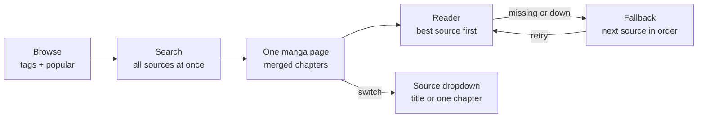

# Neko for Windows – Feature Plan

Source of truth: https://claude.ai/artifact/QUEq4JWXrDqzBaP2HnLCc5 (exported Nov 12, 2026)

## Overview

The fork brings [Neko](https://github.com/nekomangaorg/Neko) — the free, open-source, unofficial MangaDex reader — from Android to Windows. Upstream is a Kotlin/Jetpack Compose Android app (Android 8+), forked from Tachiyomi and TachiyomiJ2K, licensed Apache-2.0.

Assumptions to confirm:

- Base is `nekomangaorg/Neko` `main`; keep the Apache-2.0 LICENSE and the upstream copyright notices.
- Goal is a native Windows desktop app (Windows 10/11), not an Android emulator wrapper.
- MangaDex stays the main source; merge sources come later.

## Fork features (your additions)

The fork's headline feature is **one manga page per title that merges every source**, with a source dropdown on that page and automatic fallback when a source is missing chapters.

### 1. Unified manga page (all sources in one)

- Every title gets one canonical page, keyed by its AniList ID (with MangaDex ID as backup), not one page per source.
- On opening, the app searches all enabled sources for that title in parallel and matches results by AniList / MAL IDs, then by normalised title + alt titles.
- Chapter list is merged: one row per chapter number, with the best available source picked automatically (your priority order).
- **Source dropdown on the manga page** lets the reader switch the whole title, or a single chapter, to another source without leaving the page.
- If a source is down or lacks a chapter, the reader falls back to the next source and shows a small badge saying which one it used.
- Builds on Neko's existing merge feature, which already fills MangaDex gaps from other sources.

If a title is N/A on one source, the same page still opens: the reader picks the next source automatically, or you switch it from the dropdown.

### 2. Tag browsing + popular page (Comick-style)

- Browse by tags and genres with include / exclude chips, plus demographic, status, year and format filters.
- Popular, trending and new-releases pages as horizontal shelves on the Browse home.
- Search runs across all sources at once and de-duplicates into unified titles.
- Note: Comick shut down in September 2025 under anti-piracy pressure, and lookalike domains since then are reported as unsafe — so do not build on its API. Get tags, genres and popularity from **AniList's GraphQL API** (and MangaDex tags), which provides tag search plus trending and popular lists.

### 3. AniList synchronisation

- Log in with AniList OAuth (system browser + localhost redirect).
- Two-way sync: reading status, chapter progress, score, start / finish dates.
- Import your AniList list into the library on first login; push progress after each chapter.
- Neko already ships an AniList tracker, so this extends existing code rather than starting fresh.

### 4. Liquid glass design

- Liquid Glass is Apple's design language, so Windows has no built-in version. Recreate the look in Compose: translucent panels with background blur, rounded corners, soft highlights and depth.
- Use Windows 11 **Mica / Acrylic** for the window backdrop and a blur library such as Haze for in-app glass panels (nav bar, toolbars, source dropdown, reader controls).
- Keep text contrast readable on busy cover art; add a "reduce transparency" setting and a solid fallback for Windows 10.

## Feature inventory

Neko's features fall into 10 areas; fill the Fork column with keep, change or drop. Rows marked (J2K) are inherited from TachiyomiJ2K — verify each against the current app before you build it, since the README lists only the headline features.

| Area | Neko feature | Windows notes | Fork |
| --- | --- | --- | --- |
| MangaDex | Browse, search, filters (tags, demographic, status, content rating), latest updates, random manga | Same MangaDex API; desktop search bar + filter side panel | |
| MangaDex | Native login to MangaDex | OAuth login via the system browser + localhost redirect | |
| MangaDex | MDList / follows sync, two-way read-status sync | Same API; run sync on a background timer | |
| MangaDex | Chapter language filter; filter or block scanlation groups | Same | |
| Library | Library with categories, sort, filter, badges (J2K) | Grid + list views sized for a mouse and wide screens | |
| Library | Library update check for new chapters (J2K) | Replace Android WorkManager with an in-app scheduler + Windows toast notifications | |
| Details | Manga page: description, chapter list, mark read / unread, bookmarks (J2K) | Two-pane layout: details left, chapters right | |
| Reader | Paged left-to-right / right-to-left, vertical, webtoon, dual page | Keyboard + mouse wheel navigation, fullscreen (F11), zoom | |
| Reader | Reader settings: crop borders, background colour, page layout (J2K) | Same, plus window-size-aware fit modes | |
| Offline | Download chapters, download queue, offline reading | Download folder in user's Documents or a chosen path | |
| Tracking | MyAnimeList, AniList, Kitsu, MangaUpdates, MangaBaka | OAuth flows via system browser | |
| Discover | Computer-generated similar manga + user recs from MAL, MangaUpdates, AniList | Same | |
| Merge | Fill missing chapters from Atsumaru, Toonily, Weeb Central, Project Suki, Comix, Suwayomi, Komga | Each source is a separate scraper — later phase | |
| App | History, backup / restore, settings, themes (J2K) | Backup format compatible with Android Neko so users can move over | |

Source: [Neko README](https://github.com/nekomangaorg/Neko).

## Tech approach

Recommended: **Compose Multiplatform for Desktop (Kotlin/JVM)**. Neko is already Kotlin + Compose, so most UI and almost all networking and data code can move over; only Android-only libraries need swapping.

| Option | Reuse of Neko code | Pros | Cons |
| --- | --- | --- | --- |
| Compose Multiplatform Desktop | High (Kotlin, Compose UI, OkHttp, serialization) | Same language and UI toolkit; packages to `.msi` / `.exe` | Must replace Android-only parts; JVM app size |
| Rewrite (e.g. Tauri, Electron, WinUI 3) | None — reference only | Small native app (Tauri/WinUI) or web UI skills | Re-implement every feature from scratch |
| Run Android Neko via an emulator / WSA | Full | Zero porting | Not a real Windows app; Windows Subsystem for Android is discontinued |

Android-only pieces to replace when porting:

- **Background work** (WorkManager) → coroutine scheduler while the app runs, optional tray mode.
- **Database** → keep SQLDelight/Room if KMP-compatible versions are used, otherwise move to SQLDelight with the JVM SQLite driver.
- **Image loading and page zoom** (Coil, Android image views) → Coil 3 (multiplatform) + a Compose zoomable image.
- **Preferences, file storage, notifications, intents** → JVM preferences / DataStore, `java.nio` paths under `%APPDATA%`, Windows toast notifications, system browser for OAuth.

Reference project: [Suwayomi-Server](https://github.com/Suwayomi/Suwayomi-Server) already runs Tachiyomi-style logic on desktop JVM — useful for how others solved the same porting problems.

## Roadmap

First milestone: open the app on Windows, search MangaDex and read a chapter. Each phase ends with something you can run.

1. **Phase 0 — Groundwork**
   - Fork the repo, build the Android app once so you know the baseline.
   - Add a `desktop` Compose Multiplatform module; move shared code (models, MangaDex API client, parsers) into a `shared` module.
   - Set up CI on `windows-latest` that builds the desktop app.
2. **Phase 1 — Browse and read (MVP)**
   - Liquid glass design system first (Mica backdrop, blurred panels, reduce-transparency fallback), then MangaDex search, AniList-powered tag browse and popular page, manga details, chapter list with language filter.
   - Reader: paged right-to-left and webtoon modes, keyboard + mouse navigation, fullscreen.
3. **Phase 2 — Library and offline**
   - Local database, library with categories, read progress, history.
   - Download queue and offline reading; library update check with Windows notifications.
4. **Phase 3 — Accounts and sync**
   - MangaDex login, follows / MDList sync, two-way read status.
   - AniList two-way sync first (fork priority), then MyAnimeList, Kitsu, MangaUpdates, MangaBaka.
5. **Phase 4 — Feature parity**
   - All reader modes and settings, scanlator filters, similar-manga recommendations.
   - Backup / restore compatible with Android Neko; themes.
6. **Phase 5 — Merge sources + release**
   - Unified manga page: source adapters, title matching by AniList ID, merged chapter list, source dropdown and automatic fallback; add sources one by one (Komga and Suwayomi first, since they are self-hosted APIs).
   - Installer (`.msi`), auto-update, code signing.

Windows-only extras to consider:

- [ ] Multi-window: details in one window, reader in another
- [ ] Two-page spread tuned for wide monitors
- [ ] Gamepad / pen navigation in the reader
- [ ] System tray with background update checks

## Working with Claude Code

Give Claude Code one phase at a time, with this plan in the repo so every session starts from the same context.

- Save this plan as `docs/PLAN.md` and add a short `CLAUDE.md` at the repo root: goal (Windows desktop port), module layout, build command, and "keep Android build working" if you want both.
- Start each session with one roadmap item, e.g. "Phase 0: add a Compose Desktop `desktop` module that opens an empty window".
- Ask it to map Android-only dependencies first (grep for `android.`, WorkManager, Coil, Room) before moving code.
- Have it run the Gradle desktop build and tests after every change, and commit per feature.
- Tick the Fork column and roadmap boxes as features land.

## Open questions

- [x] Keep the Android app building in the same repo, or Windows-only? **Windows-only.** Android modules stay as porting source; build with `-PdesktopOnly`.
- [ ] Compose Multiplatform, or a different stack you already know?
- [ ] Is backup compatibility with Android Neko required?
- [ ] Which merge sources matter to you, if any?
- [ ] Distribution: GitHub releases only, or Microsoft Store too?
- [ ] Check MangaDex API terms (rate limits, image-server reporting, attribution) before release.
