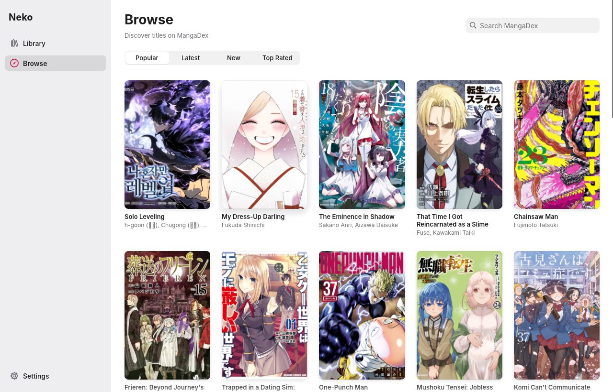
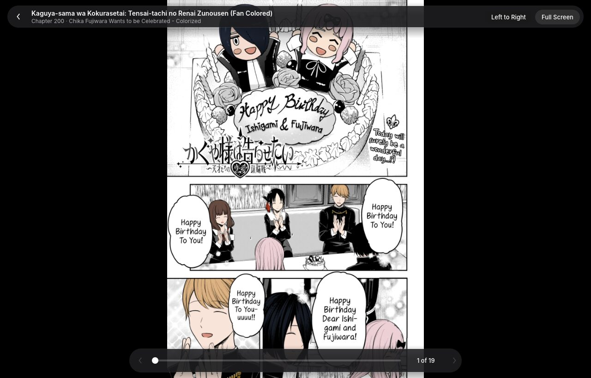
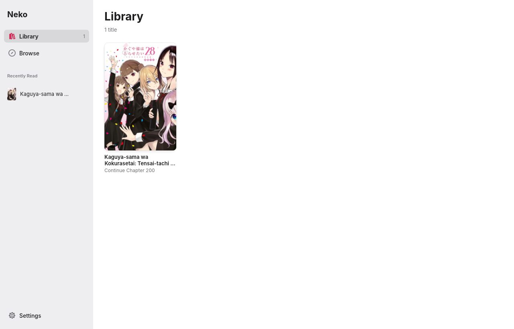
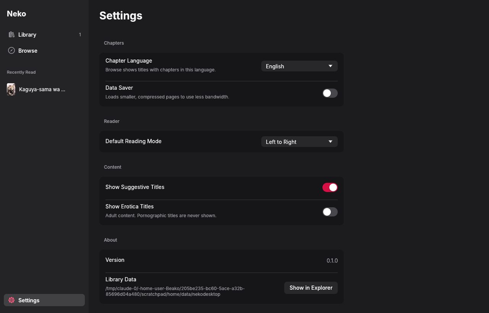

# Neko for Windows

A rebuild of Neko's core reading experience as a native Windows desktop app, written in Rust
with [egui](https://github.com/emilk/egui) and designed in Apple's design language.



| Title details (dark) | Reader |
| --- | --- |
|  |  |

| Library | Settings (dark) |
| --- | --- |
|  |  |

## What it does

- **Browse** MangaDex by Popular, Latest, New, or Top Rated, or search by title. Results load
  as you scroll.
- **Title details**: cover, authors, status, tags, description, and the full chapter list in
  your language, newest or oldest first. Right-click a chapter to mark it read or unread, or to
  mark every earlier chapter as read. Chapters hosted by a publisher open in your browser.
- **Reader**: paged (left to right or right to left) or vertical scroll for webtoons. Turn
  pages with the arrow keys, Space, Page Up/Down, the mouse wheel, or by clicking the left and
  right thirds of the page. `[` and `]` jump between chapters, `F` or F11 toggles full screen,
  and Esc closes the reader. Pages load ahead of you. If a MangaDex@Home server fails, the page
  comes from MangaDex's own server instead.
- **Library**: saves titles locally with your place in each one. Reopening a title picks up
  where you left off, and the sidebar lists recently read titles.
- **Settings**: chapter language, Data Saver, default reading mode, and content filters.

Your library and progress are saved to `%APPDATA%\Neko\Neko Desktop\data\library.json`.
Cover thumbnails are cached in `%LOCALAPPDATA%\Neko\Neko Desktop\cache`.

Not ported yet from the Android app: MangaDex login and follows sync, trackers (MAL, AniList,
Kitsu, MangaUpdates), merged sources, downloads for offline reading, and backups.

## Design

The interface follows Apple's Human Interface Guidelines, adapted for a Windows window:

- **Structure**: a sidebar for top-level navigation (Library, Browse, Settings), large titles,
  and inset grouped lists with hairline separators. Settings is a short grouped form with
  switches.
- **Type**: the bundled [Inter](https://rsms.me/inter/) family, which is close to SF Pro.
  Body text is 14 pt and nothing is smaller than 11 pt. On Windows, the system's Japanese,
  Korean, and Chinese fonts are used as fallbacks.
- **Color**: semantic tokens with light and dark values, defined in `src/theme.rs`. The app
  follows the Windows light/dark setting and has no in-app appearance switch. Neko's red is
  kept for the primary action and the selection. Every text color meets WCAG AA; the ratios are
  noted next to each token.
- **Reader**: pages sit on black, and the controls float above them on a translucent layer that
  fades after 2.5 seconds without mouse movement. Glass is used only for these floating
  controls, never for content.
- **Accessibility**: every custom control reports its role and label to screen readers
  (AccessKit), shows a focus ring for keyboard use, and works with Tab and the keyboard. Read
  state is shown with a symbol as well as color.

## Build

You need a Rust toolchain (1.85 or newer, for edition 2024).

On Windows:

```bash
cargo run --release
```

The release `.exe` is `target\release\neko-desktop.exe`. It's self-contained, so you can copy
it anywhere. It needs an OpenGL 2.0+ driver, which every current Windows GPU driver provides.

Cross-compiling from Linux with MinGW:

```bash
rustup target add x86_64-pc-windows-gnu
```

```bash
cargo build --release --target x86_64-pc-windows-gnu
```

The `Neko Desktop (Rust)` GitHub Actions workflow builds and tests on Windows. It uploads
`neko-desktop.exe` as the `Neko-windows-x64` artifact.

For development on Linux or macOS, `cargo run` works too. Set `NEKO_APPEARANCE=light` or
`NEKO_APPEARANCE=dark` to force an appearance when taking screenshots.

## Layout

| File | Purpose |
| --- | --- |
| `src/api.rs` | MangaDex API client and response parsing |
| `src/jobs.rs` | Background thread pools for API calls and image downloads |
| `src/images.rs` | Texture cache with least-recently-used eviction |
| `src/library.rs` | Library, reading progress, and settings persisted as JSON |
| `src/theme.rs` | Design tokens: colors, type scale, spacing, fonts |
| `src/widgets.rs` | Buttons, segmented control, search field, symbols, and more |
| `src/app.rs` | App state, navigation, and the sidebar shell |
| `src/browse.rs`, `library_view.rs`, `details.rs`, `settings_view.rs`, `reader.rs` | Screens |

Inter is licensed under the SIL Open Font License; see `assets/fonts/OFL.txt`.
