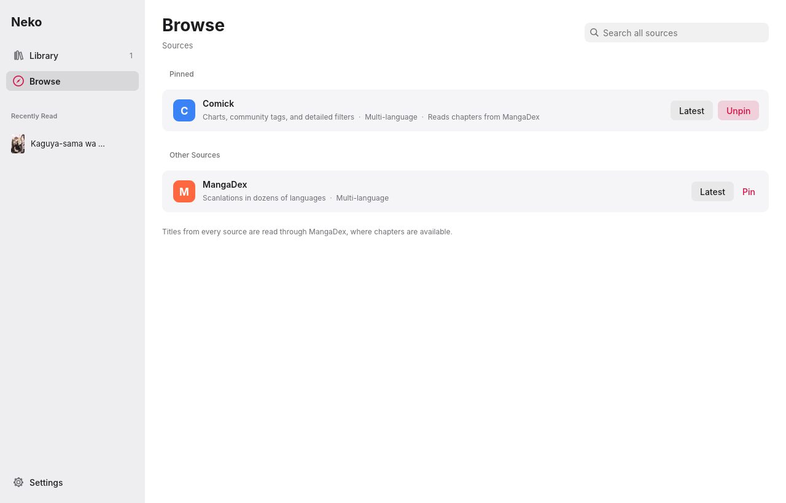
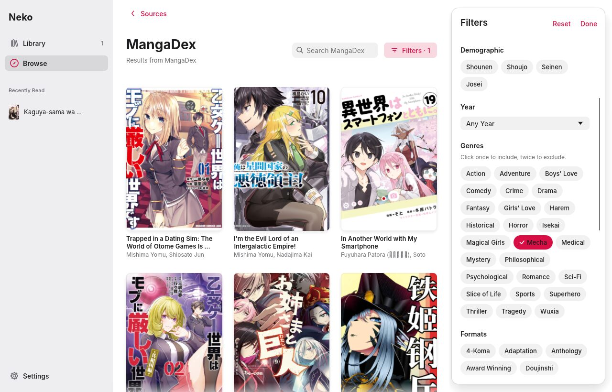
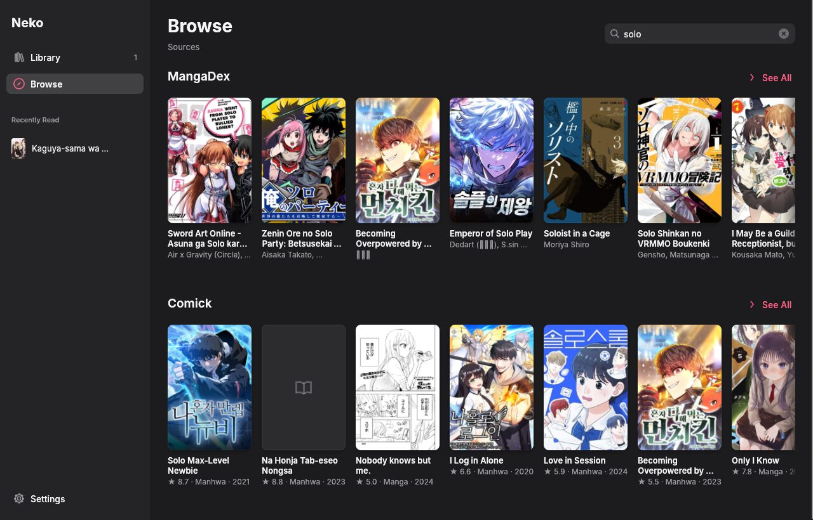
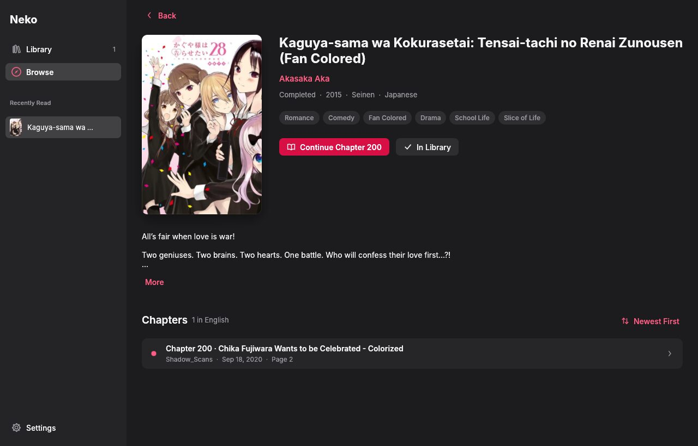
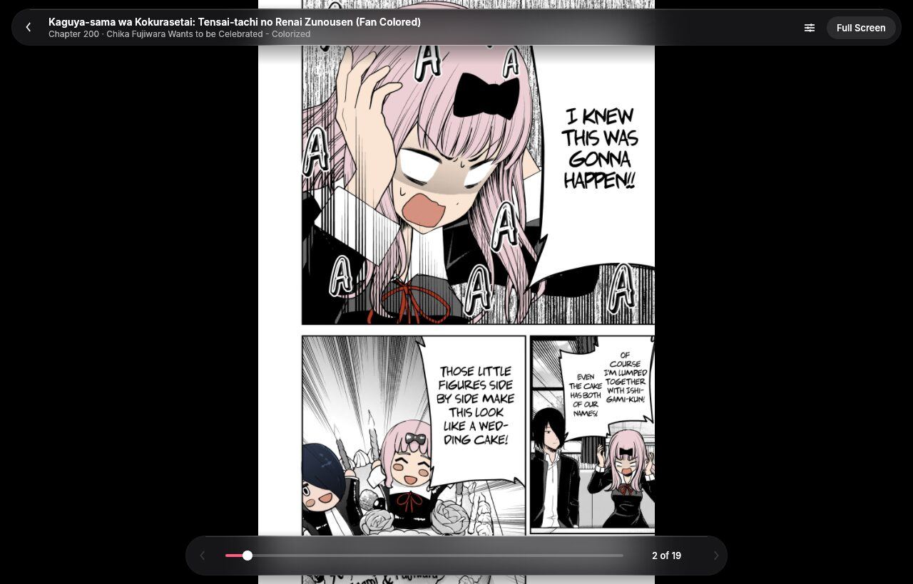
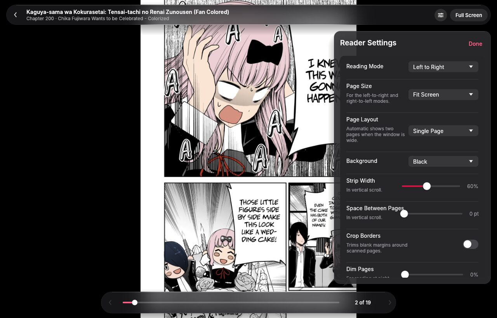
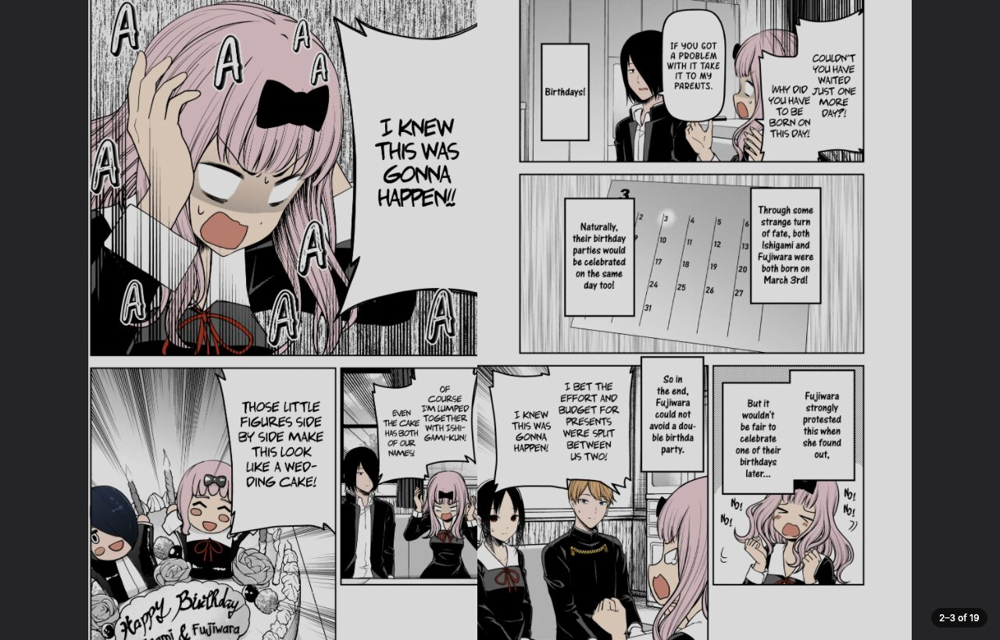
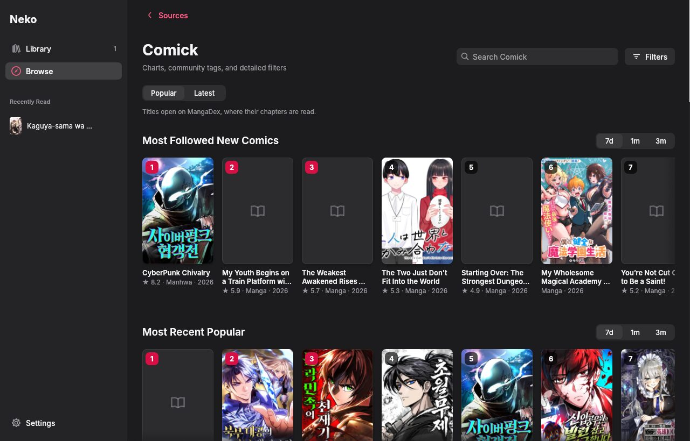
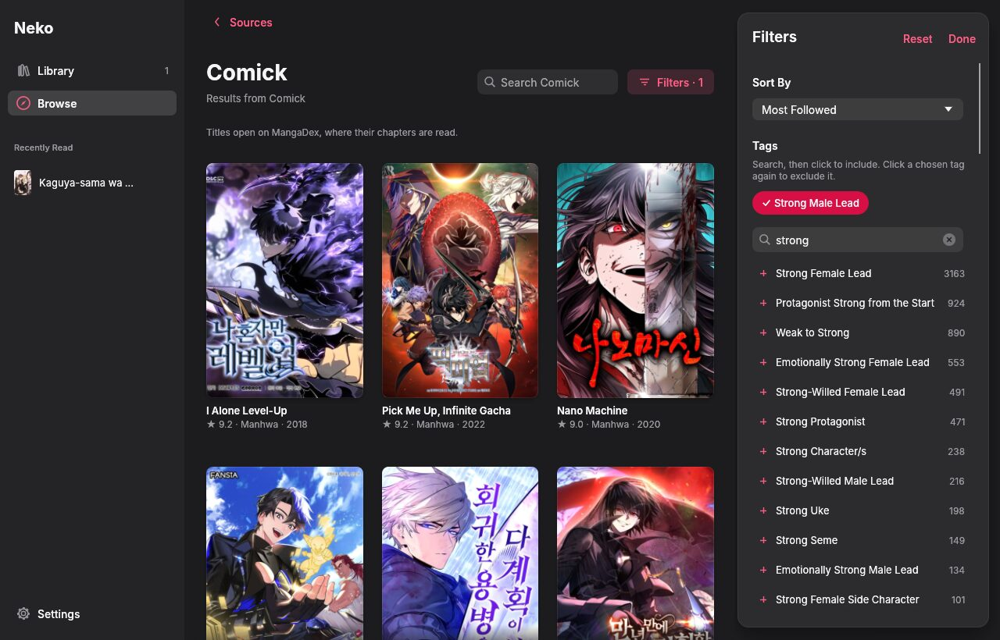

# Neko for Windows

A rebuild of Neko's reading experience as a native Windows desktop app, written in Rust with
[egui](https://github.com/emilk/egui) and designed in Apple's design language.



| A source with its filters | Search across all sources |
| --- | --- |
|  |  |

| Title page | Reader with frosted controls |
| --- | --- |
|  |  |

| Reader settings | Two-page spread |
| --- | --- |
|  |  |

| Comick charts | Comick tag search |
| --- | --- |
|  |  |

## What it does

- **Sources, the way Mangayomi organizes them.** Browse lists sources grouped as Last Used,
  Pinned, and the rest. Each source opens with Popular and Latest, a search field, and its own
  Filters. A search field on the Sources screen searches every source at once.
  - **MangaDex:** scanlations in dozens of languages.
  - **Comick:** its charts (Most Followed New Comics, Most Recent Popular, Trending, each for
    the past 7 days, month, or 3 months), community tags, and detailed filters.

  Comick serves chapters only behind a browser check, so a Comick title opens on MangaDex: the
  app matches it by shared AniList, MyAnimeList, or MangaUpdates IDs, or else by exact title.
- **Filters.** Each source declares its filters from a shared set of building blocks
  (selects, sorts, check boxes, include/exclude tags, searchable tag groups, sliders), and the
  app draws them the same way for every source. Your choices are saved per source.
  - MangaDex uses Comix's tag set: genres, formats, types (Manga, Manhwa, Manhua),
    statuses, demographics, and its sort orders. These are mapped onto MangaDex's tags, and
    MangaDex's own themes are listed too. Tags are tri-state: click once to include a tag,
    again to exclude it, and a third time to clear it. You can require any or all included
    tags.
  - Comick has its own filters:
    - Genres, themes, formats, and content descriptors, each included or excluded.
    - A searchable list of its thousands of community tags, with title counts. Click a
      tag to include it, click its chip again to exclude it, or right-click a suggestion
      to exclude it directly.
    - Demographic, status, content rating, type, when the title was added to Comick,
      minimum and maximum chapters, minimum score, publication years, and sort order.
- **MangaDex account (optional).** Sign in with a
  [personal API client](https://api.mangadex.org/docs/02-authentication/personal-clients/).
  Neko then syncs your follows into the Library, shows and sets reading statuses, and mirrors
  read chapters and library changes to MangaDex. Your password is used once to sign in and is
  never stored. The client secret and refresh token go into Windows Credential Manager.
- **Comick tracker (optional).** Connect your Comick account with your own Comick developer
  app (see below). Then, from any title page, you can find the title on Comick, add it to
  your Comick library, and set its status (Reading, Completed, On Hold, Dropped, or Plan to
  Read) and score. Finishing a chapter moves the Comick progress forward automatically.
- **Title page.** It shows the cover over a soft wash of its own colors, plus metadata,
  tags, the description, and the full chapter list. Right-click a chapter to mark it read or
  unread. Chapters hosted by a publisher open in your browser.
- **Reader.**
  - Modes: left to right, right to left, or vertical scroll for webtoons.
  - Page size: fit screen, width, or height, or original size.
  - Two-page spreads (always or automatic), with the cover shown alone and wide scans
    kept whole.
  - Zoom: Ctrl + wheel, `+` / `-`, or double-click. Drag to pan.
  - Cropping of blank borders, dimming, and a black, gray, or white background.
  - Strip width and page spacing for vertical mode.
  - Click zones (which can be swapped), wheel page turns, continuing into the next chapter,
    how many pages to read ahead, when the controls hide, an always-visible page number, and
    keeping the screen on.
  - The controls float on frosted glass that picks up the colors of the page beneath them.
- **Library.** A Continue Reading shelf, every saved title with your place in it, and a
  reading-status filter when you're signed in.

Your library and settings are saved to `%APPDATA%\Neko\Neko Desktop\data\library.json`. Cover
thumbnails are cached in `%LOCALAPPDATA%\Neko\Neko Desktop\cache`.

### Keyboard

| Where | Keys |
| --- | --- |
| Anywhere | Ctrl+F search, Ctrl+1 Library, Ctrl+2 Browse, Ctrl+, Settings, Esc or Alt+← back |
| Reader | ← → / Space / Page Up / Page Down turn pages, `[` `]` previous and next chapter, `F` or F11 full screen, `S` reader settings, `+` `-` `0` zoom, Esc close |

Not ported yet from the Android app: trackers (MyAnimeList, AniList, Kitsu, MangaUpdates),
merged sources, offline downloads, and backups.

## Signing in to MangaDex

1. On [mangadex.org](https://mangadex.org/settings), open **Settings → API Clients** and create
   a personal client. MangaDex has to approve it before it works.
2. In Neko, open **Settings → MangaDex Account**. Enter your username, password, and the
   client's ID and secret, then click **Sign In**.
3. Neko adds the titles you follow to your Library. **Sync Now** pulls changes again, and
   **Sync Reading to MangaDex** controls whether reading is mirrored back.

## Connecting Comick

1. Sign in on [comick.dev](https://comick.dev/developers/apps), open **Developer apps**, and
   register an app:
   - **Client type:** Browser or mobile app without a private backend.
   - **Application platform:** Native mobile or desktop app.
   - **Permissions:** add, update, and remove library entries (`library:write`).
   - **Callback URL:** `http://127.0.0.1:47823/comick/callback`.
2. In Neko, open **Settings → Comick**, paste the app's client ID, and click
   **Connect Comick**.
3. Approve access in the browser window that opens. Neko listens on that callback address for
   the moment it takes to finish signing in.

Neko signs in with OAuth and PKCE, so no client secret is needed. It asks for `library:read`,
`library:write`, and `offline_access`. Tokens are kept in Windows Credential Manager.

## Design

The interface follows Apple's Human Interface Guidelines, adapted for a Windows window:

- **Frosted glass, where Apple uses it.** On Windows 11 the window uses the system's Mica
  material (Acrylic on Windows 10), so the sidebar is real translucent glass. Inside the app,
  floating layers use glass made from a pre-blurred copy of what's behind them: the reader's
  controls and the title-page header. Content itself is never glass.
- **Structure:** a sidebar, large titles, inset grouped lists, segmented controls, capsule
  filter chips, switches, and sliders.
- **Type:** the bundled [Inter](https://rsms.me/inter/) family, which is close to SF Pro. On
  Windows, the system's Japanese, Korean, and Chinese fonts are used as fallbacks.
- **Color:** semantic light and dark tokens in `src/theme.rs` that follow the Windows setting.
  Every text color meets WCAG AA. Neko's red is kept for primary actions and selections.
- **Accessibility:** every custom control reports its role and label to screen readers
  (AccessKit), shows a keyboard focus ring, and works with the keyboard. State is never shown
  by color alone; included and excluded tags, for example, also get a symbol and a strikethrough.

## Build

You need Rust 1.85 or newer.

On Windows:

```bash
cargo run --release
```

The release `.exe` is `target\release\neko-desktop.exe`. It's self-contained and needs an
OpenGL 2.0+ driver, which every current Windows GPU driver provides.

Cross-compiling from Linux with MinGW:

```bash
rustup target add x86_64-pc-windows-gnu
```

```bash
cargo build --release --target x86_64-pc-windows-gnu
```

The `Neko Desktop (Rust)` GitHub Actions workflow formats, lints, tests, and builds on Windows
and uploads the `.exe`. A manual run with **publish** checked, or pushing a `desktop-v*` tag,
publishes a GitHub release.

For development on Linux or macOS, `cargo run` works too. Set `NEKO_APPEARANCE=light` or
`NEKO_APPEARANCE=dark` to force an appearance for screenshots.

## Layout

| File | Purpose |
| --- | --- |
| `src/api.rs` | MangaDex API client: titles, chapters, pages, tags, follows, statuses, read markers |
| `src/auth.rs` | Personal-client sign-in, token refresh, and Credential Manager storage |
| `src/sources/` | The `Source` interface and registry (`mod.rs`), and the MangaDex and Comick sources |
| `src/filters.rs` | Generic filters that sources declare, the renderer, and saving choices per source |
| `src/comick.rs` | Comick catalog (search, genres, tags, charts) and tracker (OAuth with PKCE, library entries) |
| `src/jobs.rs` | Background thread pools, image decoding, blurring, and border cropping |
| `src/images.rs` | Texture cache with least-recently-used eviction and fade-in |
| `src/library.rs` | Library, progress, statuses, and settings persisted as JSON |
| `src/glass.rs` | Window material (Mica/Acrylic), frosted panels, and keep-awake |
| `src/theme.rs` | Design tokens: colors, type scale, spacing, fonts |
| `src/widgets.rs` | Buttons, chips, segmented control, switch, slider, search field, symbols |
| `src/app.rs` | App state, navigation, sync, and the sidebar shell |
| `src/sources_view.rs`, `library_view.rs`, `details.rs`, `settings_view.rs`, `reader.rs` | Screens |

The source architecture follows [Mangayomi](https://github.com/kodjodevf/mangayomi)'s design;
no Mangayomi code is included.

Neko is unofficial and isn't affiliated with MangaDex, Comick, or Comix. Inter is licensed under the SIL Open Font License; see `assets/fonts/OFL.txt`.
